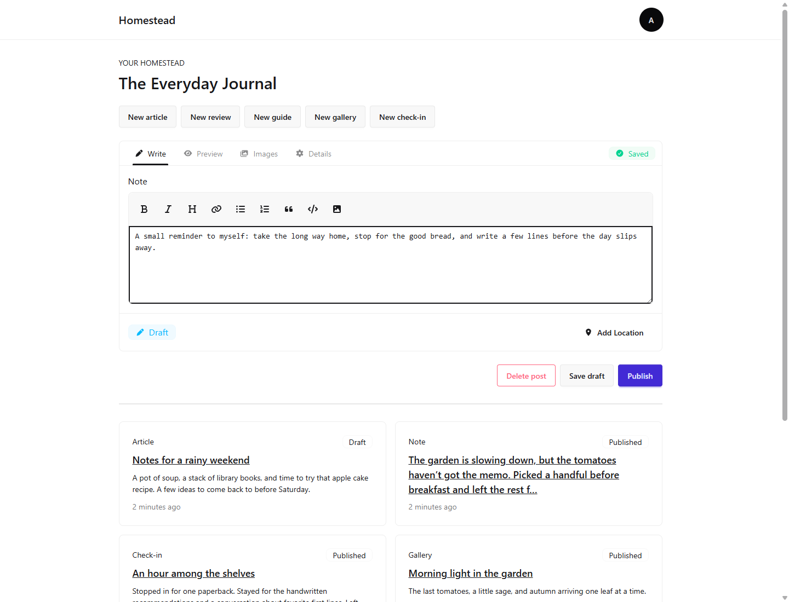
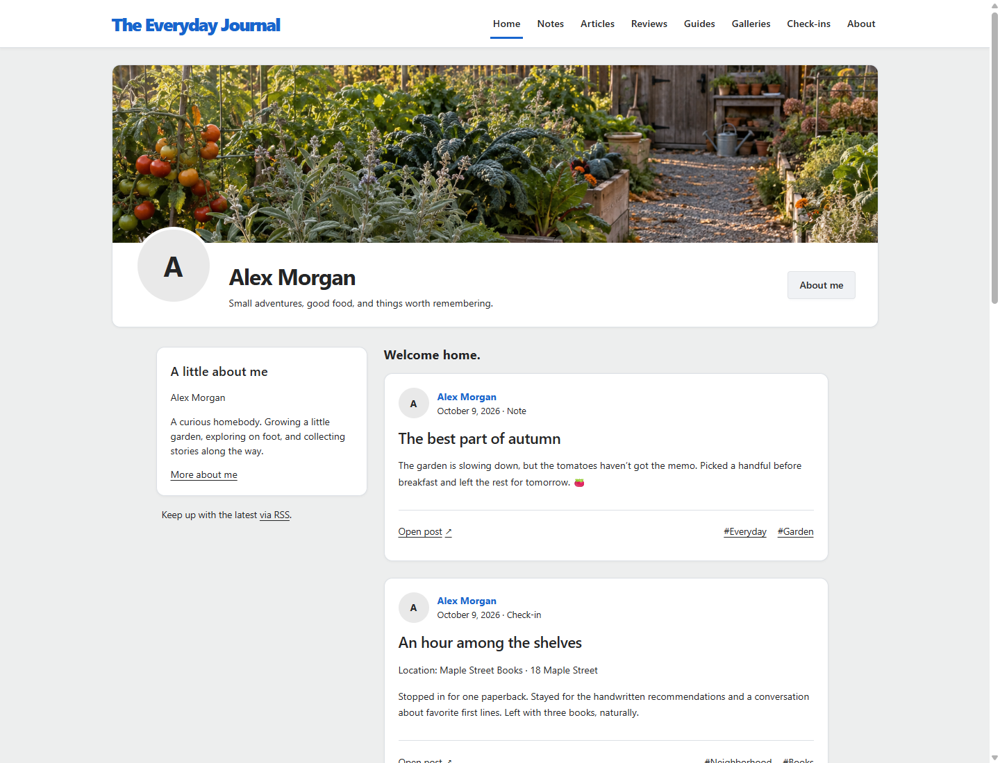

# Homestead

A self-hosted home for your digital life.

Publish notes, articles, reviews, guides, photo galleries, and check-ins from one
place. Write in Markdown with autosave, private drafts, and previews. Your public
site is static, with themes, tags, and RSS. Export it as a static site or Hugo
project, or take a full backup.

Built with ASP.NET Core, .NET 10, and SQLite. One author, one application.

## A look inside

**Administration** — write, preview, and publish from your phone or desktop.

**Public site** — sample posts using the Town Square theme.

## Get started

- **Self-host:** follow the [Docker and HTTPS deployment guide](docs/deploy.md).
- **Run locally:** see [development setup and checks](docs/contributing.md).

Create your administrator at `/setup`, personalize your site in **Settings**, and
publish your first post. Keep your data directory between restarts.

## More

- [Themes](docs/themes.md)
- [Backup and restore](docs/backup-restore.md)
- [Changelog](CHANGELOG.md)
- [Issues and feature requests](https://github.com/PoshTools/homestead/issues)

Currently a release candidate; see [release readiness](https://github.com/PoshTools/homestead/issues/22).

[MIT license](LICENSE).
