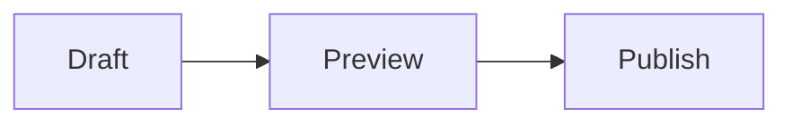

# Public themes

Select a theme in **Settings → Public theme** and save. Porch is the original
single-column feed, Journal uses a narrower serif reading layout, Ledger uses
a wider masthead and two-column feed on larger screens, and Folio pairs a bold
accent-colored cover with spacious typography and serif reading text. Town Square
uses a Facebook-inspired social feed with author avatars, rounded post cards,
a profile cover, and a full-width content column without an introduction sidebar.
Each supports every post type, ordinary navigation without JavaScript, system
light/dark appearance, the four accent presets, and optional primary, background,
and text colors.

Folio uses Razor templates for the document, navigation, footer, and
post layouts, including a distinct note layout and structured review details in
listings. Its original templates and styling take inspiration from
[Typology by Meks on ThemeForest](https://themeforest.net/item/typology-text-based-minimal-wordpress-blog-theme/19547842).
No purchased assets or external fonts are required. The sources in
`src/Homestead/Themes/folio` also serve as a built-in Razor authoring example.

Town Square is the default for new sites under **Settings → Public theme**.
Existing sites retain their saved theme selection. The selector shows theme names
and versions without a color-support badge; optional color overrides still work.
Its Razor sources live in `src/Homestead/Themes/townsquare`. Feeds, post pages,
and private previews use the full content width within the centered page layout;
the About page remains accessible from the navigation and home profile cover. Notes,
galleries, and check-ins show their full content in the feed; articles, reviews,
and guides link from previews to their complete post. The post-opening arrow is
an icon-only borderless button to the left of the social sharing buttons. Its hover
title and accessible name are “Open post” in listings and “Permalink” on post
pages and private previews. It remains available when sharing is disabled;
tags appear above the action row. Share buttons wrap on narrow screens.
All navigation works without JavaScript. Styling is original, with no Facebook
assets or external fonts.

Town Square displays photo captions in an always-visible translucent dark strip
over the bottom of each photo on feeds, post pages, and private previews. Captions
wrap and stay readable in light/dark appearance without hovering or JavaScript.
Full-size gallery image pages keep their captions below the uncropped image.

## Mermaid diagrams

Use a fenced `mermaid` block in any post body or guide step:

````markdown

````

Diagrams render in the browser using the pinned, locally bundled Mermaid runtime;
no CDN, external fonts, or production Node.js service is required. Add `accTitle`
and `accDescr` in Mermaid for an accessible title and description. Readers can
expand **Diagram source** with the keyboard. Without JavaScript, if assets cannot
load, or if the syntax is invalid, the encoded source remains readable. Invalid
diagrams do not prevent publication. RSS retains the readable source.
Diagrams are limited to 50,000 characters and 500 edges; larger definitions keep
their source fallback. HTML labels, click actions, and external images are disabled.

Porch, Journal, Ledger, Folio, and Town Square share responsive diagram styling and
light/dark rendering. Their existing feed rules still apply: excerpt-only cards
link to the complete post, where diagrams render. Private previews use the same
renderer with authenticated, no-store assets under `/admin/mermaid/`; draft sources
never enter the public generation. Shared diagram CSS applies to each theme's
post and note overrides. Custom templates should preserve `Model.Head` and render
`ContentHtml`, `BodyHtml`, or step `BodyHtml` without modifying `[data-mermaid]`
wrappers. No theme model members, manifest fields, or database migration are added.

Only generations containing diagrams copy the bundled runtime into their exact
public allowlist at `/assets/mermaid/`. Static ZIPs retain that runtime and work
independently of Homestead over HTTP(S). Hugo ZIPs preserve Mermaid fences, include
a code-block render hook and the local runtime, and render diagrams after building
with Hugo. Backups preserve the original Markdown as ordinary post content.

## Gallery image pages

Each published gallery photo has a static page at
`/posts/{slug}/photos/{media-id-without-hyphens}/`. Clicking a gallery image on
home/type/tag timelines or the post opens its page using an ordinary link. Each
page shows the uncropped optimized image at its natural size, shrinking to fit
the available width, its caption and alt text, a full-resolution image link,
and Back to gallery / Previous photo / Next photo navigation in saved photo order.
Retained originals remain private. All five built-in themes use this shared page;
Folio and Town Square's post overrides preserve the image links. No JavaScript
is used. Pages have their own canonical URL and social image, appear in the
sitemap and active file allowlist, and are included in static exports. Builds
use committed snapshots, so drafts, failed builds, and removals follow the same
activation rules as their parent gallery.

Private previews link to `/admin/posts/{id}/preview?image={media-id}`. These
authenticated, no-store, noindex pages render the current draft and private
media without generating public files. Unknown or foreign image IDs return 404.

`ThemeMediaModel.ImagePageUrl` supplies a gallery photo's page URL (or its private
preview URL); it is null for other media. Custom listing/post templates should
wrap gallery images in a normal anchor using this value. Shared `ContentHtml`
already includes these links, including inline Markdown photos. On image pages,
`Model.GalleryImage` identifies the selected photo, `Model.IsListing` is false,
and `Model.CanonicalUrl` points to the photo page. Post/type overrides are skipped;
Content/Main overrides should preserve `Model.DefaultContent`/`Model.Content`
to retain the shared image viewer. No manifest fields or database migration are
needed. Custom CSS should preserve the uncropped `[data-gallery-image]` rendering.

## Public appearance

Colors use six-digit hex values such as `#25613e`. Empty fields restore theme
defaults. Overrides apply in both light and dark mode, so check that your text and
background remain readable in each. Primary foreground color is chosen
automatically for contrast. A custom theme can decline color overrides.

Administration has a separate **Appearance** selector for System, Light, or Dark.
That preference is stored in the current browser and does not change public pages.

Upload a public favicon in **Settings → Images → Favicon**. JPEG, PNG, and WebP
use the same validation and private original storage as other branding images;
a square image works best. Without a custom favicon, public pages use the bundled
256-pixel Homestead PNG. Administration always uses that Homestead icon. Removing
the custom favicon restores the default on the next successful build. Failed builds
keep the previously active favicon, and replaced originals are no longer public.

All five built-in themes include the favicon through the shared head, including
Folio and Town Square's document overrides. `Model.Site.Favicon` is the optional
custom image; `Model.Site.FaviconUrl` and `Model.Site.FaviconMimeType` describe the
effective icon, including the default. Custom document templates should preserve
`Model.Head`, or emit an icon link using those effective values. Private previews
use authenticated custom media URLs or the bundled default. Static exports retain
the active favicon; Hugo exports bundle the saved custom favicon or default and
reference it through `relURL`, so both work independently of Homestead. Legacy
settings and generation manifests without `FaviconMediaId` use the default when
rebuilt. This setting adds a nullable media reference without altering post data.

Every built-in theme includes an **Admin** link at the end of its main navigation,
including on listings, post pages, and private previews. Porch, Journal, and
Ledger use the shared header; Folio and Town Square render `Model.Navigation`.
The ordinary link works without JavaScript and points to the saved canonical
site's `/admin` dashboard, which requires sign-in. Static and Hugo exports keep
this absolute link to the original Homestead instance; remove it from exported
pages if that instance is retired. Custom Header or Main templates should preserve
the Admin entry in `Model.Navigation`, or include the shared header.

Settings are saved before building. A successful build atomically activates all
theme changes. If it fails, the previous complete site stays public; Settings
shows the active theme and the rebuild failure. Use **Rebuild site** to retry.

Scheduled posts and updates use the same renderer and atomic activation as an
immediate publication. The schedule's frozen content stays private until its due
time; ordinary rebuilds cannot include it early. All five built-in themes render
the resulting snapshot through their existing listings and post templates.
Scheduled updates retain the original permalink and first-publication date;
new posts use the scheduled UTC instant as their publication date, including
after downtime. Private previews continue to show the current draft, which may
differ from the scheduled copy. Scheduling adds no public model members, manifest
fields, CSS, or theme authoring requirements. Custom themes need no scheduling
logic. Static exports include only the active generation, and Hugo exports keep
scheduled copies in separate `draft: true` bundles with `homestead_scheduled_at`.

If **Settings → Backup** is configured to back up before publication, the engine
uploads a complete private backup before rendering any theme. A failed upload
keeps the active generation and theme unchanged, with saved changes pending.
This applies to all built-in and custom themes. Backup configuration and credentials
are private and are absent from public theme models and generation manifests.
Theme templates need no backup handling; private previews do not trigger backups.

The shared footer shows “Made at home with Homestead”,
with the bundled Homestead icon before the name linked to
`https://github.com/adamdriscoll/homestead`. Custom footer credits should use this
repository URL as well. Administration also shows
the icon before its Homestead title. The footer always uses the Homestead icon,
including when a custom public favicon is selected. All five built-in themes
support it, including Folio's footer override. Images have empty alternative text
because the adjacent link text supplies their accessible name. To remove it, check
**Settings → About → Hide Homestead credit** and save. The preference also
applies to private previews and Hugo exports; static exports keep the currently
active footer. Razor themes replacing the footer or entire document must honor
`Model.Site.HideHomesteadCredit` themselves, or include the shared footer.
`Model.Site.HomesteadIconUrl` supplies the bundled icon URL for custom attribution:
`/assets/favicon.png` on public pages and `/logo.png` in private previews. Builds
and exports include that asset whenever needed for the default favicon or visible
attribution. Hugo uses `relURL` so the icon also works when hosted in a subdirectory.

Enable optional sharing buttons in **Settings → Social**. Bluesky, Facebook, X,
LinkedIn, Reddit, and email can each be selected independently; all start disabled.
Every built-in theme shows enabled buttons on post details and home/type/tag feed
cards for all seven post types. Buttons show only 16-pixel service icons, with no
border or shadow. The post-opening arrow uses the same size and styling.
Invisible padding retains at least 44-pixel touch targets, and keyboard focus
remains visible. Buttons have no visible “Share:” prefix or service text.
Each link has a native hover title and an
accessible name such as “Share via Bluesky”; decorative SVGs are hidden from
assistive technology. Buttons are ordinary links using the published
display title and the saved canonical URL, with no third-party scripts or requests
until a reader follows a link. Private previews omit sharing, including previews
of posts that are already published. Saving rebuilds the site; a failed build
leaves the active buttons unchanged until a successful rebuild. Static ZIPs retain
the active buttons. Hugo exports use the saved selections and Hugo permalinks,
so changing Hugo's base URL also changes the shared URLs.

Post templates replacing shared rendering should iterate `Model.Post.ShareLinks`
to honor these choices, including in listings. Each entry has an encoded sharing
destination in `Url` and a service name in `Label`; render `Url` as a normal Razor
attribute. Use `Homestead.Features.Publishing.SocialSharing.RenderIcon(link.Label)`
as a `MarkupString` for the shared server-owned inline SVG. Keep `Label` in the
link's `title` and `aria-label` attributes (for example, “Share via Email”),
and use borderless ghost buttons with 16-pixel icons and at least 44-pixel touch
targets. No new model members or external icon assets are required.
The array is empty when sharing is disabled or the page is a private preview.
Use accessible link labels, wrap buttons on narrow
screens, and preserve keyboard focus, touch targets, and light/dark colors.

## Newsletter navigation and forms

**Settings → Newsletter** optionally enables Brevo email delivery. Every built-in
theme includes a Newsletter link in its shared or custom header. Porch, Journal,
and Ledger use the shared header; Folio and Town Square iterate `Model.Navigation`.
The link is an absolute URL to the saved canonical site's `/newsletter/` endpoint,
so static and Hugo exports can still direct readers to the original subscription
service. Exports contain no subscriber addresses, API keys, or subscription forms.
Keep the original Homestead service available for subscription links, or remove
the link when migrating away from it.

The public form uses the active theme's shared regions, CSS, and ordinary POST
forms, including confirmation, preferences, and unsubscribe. It works without
JavaScript and supports system light/dark appearance. These request-only pages
are never generated or added to the public file allowlist. They have no-store,
no-referrer, and noindex responses; their explicit opt-in routes use private SQLite
for subscription handling. Regular public pages remain static. Private post
previews show the navigation but never embed subscriber forms or reader data.

`ThemeSiteModel.EnableNewsletter` exposes only the active public navigation
preference. `Model.Navigation` includes the canonical Newsletter URL when enabled.
Header and Main overrides should preserve this navigation; compare link URLs to
`Model.CanonicalUrl` as well as `Model.Path` for the current-page indication.
Content overrides must preserve `Model.DefaultContent` on `/newsletter/` to render
the forms. `Model.IsListing` is false there. No credentials or reader records are
exposed as theme model members. `DefaultContent` contains request-specific form
markup and its antiforgery token on these dynamic pages. Disabling stops subscriptions and sending
immediately; a failed rebuild can temporarily retain the old navigation link.

## Review ratings

All built-in themes display review ratings with read-only daisyUI stars on home,
type, and tag listings, post pages, and private previews. The selected star uses
`aria-current="true"`; the group has an accessible “Rated N out of 5” label and
screen-reader text retains the numeric rating. Incomplete preview drafts show
“Not rated” when their rating is null. Stars inherit the theme's text color in
light and dark appearance and require no JavaScript. Static exports retain them.

`Model.Post.Review.Rating` remains a nullable integer from 1 to 5. Shared
`Model.Post.ContentHtml` and `Model.DefaultContent` include the rating display.
Post or listing overrides rendering review details themselves can use
`@((MarkupString)Homestead.Features.Publishing.SafeMarkdown.RenderRating(review.Rating))`
inside a wrapping container alongside the encoded subject. This uses the shared
CSS and handles null ratings; no additional model members or theme assets are
required. The editor uses five radio stars. New drafts can remain unrated; once
selected, a rating can be changed to another value from 1 to 5. Ordinary forms
preserve nullable drafts and the required 1–5 publication rating.

## Install a custom theme

Upload a ZIP in **Settings → Install a custom public theme**, then select the
installed theme and save. Uploading alone does not change the public site. An
identical upload reuses its installation. Changed packages install separately,
allowing you to select an earlier version. Save text settings before uploading.

Themes can contain JavaScript that runs on the public site's origin. Razor
templates also execute C# on the server, with the application's permissions
and access to private data, credentials, and files. They are **trusted code, not
sandboxed templates**. Install only packages from authors you trust. Installation
compiles templates and reports syntax/model errors before saving the package.
Rendering errors prevent activation and leave the previous complete site public.

Private previews use the same templates with authenticated media URLs. The shared
head omits theme scripts, and Content Security Policy allows only bundled diagram
scripts (plus bundled maps in fitness previews). Inline and theme scripts remain
blocked. Razor server code still runs in previews. Public
content and navigation must work without scripts.

ZIPs may be at most 5 MB compressed and 20 MB expanded, with at most 128 entries.
Put `theme.json` at the ZIP root; don't wrap the package in an extra directory.
Directory entries are allowed. Filenames use letters, numbers, dots, underscores,
and hyphens, start with a letter or number, and use `/` between directories.
Traversal, absolute paths, symbolic links, duplicate paths (including differences
only in case), Windows device names, and unsupported files are rejected. Paths
are case-sensitive when referenced by the manifest.

Supported files are `.css`, `.js`, `.png`, `.jpg`, `.jpeg`, `.webp`,
`.woff`, `.woff2`, and `.razor`, plus the root `theme.json`. Razor files
are private sources and are never served as assets. Standalone C# files, DLLs,
project files, and `.cshtml` are not accepted.

## Package format

Themes use Razor templates and shared public components. The manifest declares
supported post types, styles, scripts, optional colors, and template mappings.
`formatVersion` identifies the package schema; `version` is the author's release
label. Theme rendering has one contract.

```text
theme.json
theme.css
Main.razor
Header.razor
Note.razor
fonts/reading.woff2
```

New themes should declare all seven post types, including `fitness`. Notes use
`microblog`, and check-ins use `checkin` in the manifest. Existing six-type packages
remain installable; fitness posts use the shared post fallback when the package
does not declare `fitness`, bypassing its generic Post override. Content/Main
overrides that build their own listings must still include these posts. All referenced styles, scripts, and templates must
exist. `styles` needs at least one entry; `scripts` can be empty. Both arrays have
a maximum of 16 entries. `supportsColors` defaults to false. Names have a maximum
of 80 characters, release labels 40, and manifests/Razor sources 64 KB each.
Unknown manifest fields are rejected.

Homestead compiles its shared public Razor components with the application.
[`SiteDocument.razor`](../src/Homestead/Components/Public/SiteDocument.razor)
renders the document head, header, main content, and footer;
[`PostContent.razor`](../src/Homestead/Components/Public/PostContent.razor)
renders all seven post types and optional locations. Themes can replace these
regions with Razor templates or use the shared defaults. This keeps escaping,
metadata, media resolution, previews, and navigation consistent across themes.

## Razor templates

Start with the [Razor Garden example](../examples/themes/razor-garden/theme.json).
ZIP the contents of that directory with `theme.json` at the root. Its `Main.razor`
replaces the document, `Header.razor` replaces the header, and `Note.razor` replaces
notes. Remove any template to use the shared default for that part.

A theme can use named files at the ZIP root (`Main.razor`,
`Header.razor`, etc.) or map names to source files explicitly:

```json
{
  "formatVersion": 1,
  "name": "Razor Garden",
  "version": "1.0.0",
  "postTypes": ["microblog", "article", "review", "guide", "gallery", "checkin", "fitness"],
  "styles": ["theme.css"],
  "scripts": [],
  "supportsColors": true,
  "templates": {
    "Main": "templates/Main.razor",
    "Header": "templates/Header.razor",
    "Post": "templates/Post.razor",
    "Note": "templates/Note.razor"
  }
}
```

Names and paths are case-sensitive. Explicit mappings take precedence over
root filenames. A mapping must name one of the following templates and reference
an existing `.razor` source. All mapped templates compile together, including
ones that currently have no matching posts. Unreferenced sources remain private.

| Template | Replacement and fallback |
| --- | --- |
| `Main` | Entire HTML document. Without it, Homestead supplies the document, head, skip link, and shared regions. |
| `Header` | Shared header on every page. |
| `Content` | Entire main region on feeds, post pages, About, tag pages, and the map. Include `main id="main"` for the skip link. |
| `Footer` | Shared footer on every page. |
| `Post` | Entire post detail or feed card, when there is no matching type template. |
| `Note`, `Article`, `Review`, `Guide`, `Gallery`, `Checkin`, `Fitness` | Entire post detail or feed card of that type, preferred over `Post`. Fitness requires `fitness` in the manifest. |

Absent post templates use shared `PostDocument.razor`/`PostContent.razor` rendering.
`Model.IsListing` distinguishes feed cards from post details. Post overrides are
rendered first, then Header, Content, Footer, and finally Main. A custom Content
template can include the composed default via `Model.DefaultContent`; if it
iterates `Model.Posts` itself, it owns the post presentation.

Every template inherits `ThemeComponent` and receives an immutable
[`ThemePageModel`](../src/Homestead/Features/Themes/ThemePageModel.cs) as `Model`.
No parameter declaration or `@inherits` directive is needed. Use HTML markup,
Razor expressions, `@if`, `@foreach`, and C# helpers in `@code`. The public Razor
language compiler is pinned to 6.0.36, with Roslyn 5.0.0 targeting the application's
.NET 10 runtime. Newer framework directives, interactive rendering, child
component tags, `_Imports.razor`, and code-behind files are not supported. Common
imports include `System`, `System.Linq`, `Microsoft.AspNetCore.Components`,
`Homestead.Features.Themes`, and `Homestead.Data.Entities`; other `@using` directives
can reference assemblies already shipped with Homestead. No NuGet restore or SDK
is needed on the server. Compilation is cached for the current theme; active
public requests read only generated static files.

### Page model

| Member | Meaning |
| --- | --- |
| `Site` | `ThemeSiteModel`, the saved public settings described below. |
| `Path`, `Heading` | Root-relative page URL and listing/page heading. |
| `Preview` | True only for an authenticated draft preview. |
| `IsListing` | True for home/type/tag listings; false for post details, gallery image pages, About, map, and newsletter pages. |
| `GalleryImage` | Selected `ThemeMediaModel` on a gallery image page; null on other pages. Preserve the shared content on image pages. |
| `ThemeId`, `CanonicalUrl` | Installation ID and canonical page URL derived from saved settings. |
| `Navigation` | Ordered `ThemeLinkModel` entries (`Label`, `Url`) for Home, enabled types, About, optional Map and Newsletter, and Admin. Newsletter and Admin use absolute URLs to the saved canonical site. |
| `Post` | Current `ThemePostModel` in a post detail/type/Post template; otherwise null. |
| `Posts` | Ordered snapshots for the current listing, or map's posts; empty on details/About. |
| `Head` | Shared encoded metadata and stylesheet links as a `MarkupString`. Includes theme scripts on public pages and trusted bundled route-map scripts in fitness previews. Available to region/Main templates. |
| `Header`, `Content`, `Footer` | Rendered regions as `MarkupString`s. Main receives all replacements. Region templates see replacements completed earlier in the order above. |
| `DefaultContent` | Shared post/card for a post template; shared/composed region for a region template; complete composed document for Main. |

`ThemeSiteModel` includes `Title`, `Description`, `CanonicalBaseUrl`,
`DisplayAuthor`, `AuthorBio`, `FooterText`, `HideHomesteadCredit`, `TimeZone`,
`AccentColor`, `EnableLocationMap`, `EnabledPostTypes`, `FitnessUnits`, `ProfileLinks` (Label/Url),
sanitized `AboutHtml`, and optional `Avatar`, `Logo`, and `HeaderImage` media.
It contains public settings only, with no database entities, credentials, or
private filesystem paths.

### Post and structured models

Public models come from committed published snapshots. Private preview models
come from the saved draft and never write public output. Immutable arrays retain
snapshot ordering. Every type uses the same `ThemePostModel`, with optional
structured fields:

| Members | Meaning |
| --- | --- |
| `Id`, `Type`, `TypeLabel` | Stable ID, `PostType` enum (notes use `Microblog`), display label. |
| `Title`, `DisplayTitle`, `Url` | Authored title, title with type/date/place fallback, stable `/posts/{slug}/` link. |
| `Summary`, `Description` | Optional authored summary and generated plain-text excerpt. |
| `PublishedAtUtc`, `ModifiedAtUtc`, `DisplayDate` | Snapshot timestamps and first-publication date formatted in the site's time zone. |
| `BodyHtml`, `ContentHtml` | Sanitized Markdown body; full shared content including location, review, photos, and guide steps. Both are `MarkupString`s. |
| `Tags` | Ordered `ThemeTagModel` entries (`Name`, `Url`), preserving collision-safe tag URLs. |
| `Media`, `Cover` | Ordered media and optional selected cover. Each has `Id`, `Url`, `MimeType`, `AltText`, `Caption`, `GuideStepId`, and nullable `ImagePageUrl` for gallery photo links. |
| `Review` | Optional subject, nullable integer rating, and external URL. Preview ratings can be null. |
| `Tools`, `Materials` | Ordered guide supplies with a plain-text `Name` and optional HTTP(S) `Url`. Materials also have optional text `Quantity`. Empty on older snapshots; older materials have no quantity. |
| `ShareLinks` | Ordered `ThemeLinkModel` entries (`Label`, `Url`) for enabled sharing services, built from the published display title and canonical post URL. Empty in private previews. |
| `Steps` | Ordered `ThemeStepModel` entries with stable `Id`, optional `Title`, sanitized `BodyHtml`, step `Media`, optional `DurationSeconds`, and Humanizer-formatted `DurationText`. |
| `Location` | Optional name/address and paired nullable latitude/longitude; `Coordinates` provides display text. |
| `Activity` | Optional immutable `FitnessSnapshot` with ordered segments/points, distance in meters, nullable duration/elevation gain/start time and heart-rate averages/maxima, plus formatted distance/duration/pace. Empty on old snapshots and activities without GPX. |

All model media URLs use authenticated `/admin/media/{id}` URLs in previews and
snapshot-owned `/media/{id}/{filename}` URLs publicly. Use these URLs instead of
constructing paths. Razor encodes strings automatically: use `@Model.Post.Title`,
not casts to `MarkupString`. Only the provided sanitized HTML and rendered regions
should bypass encoding. Incomplete preview drafts can have empty text/media/steps
and null review/location/cover data. Templates must handle those cases.

For example, `Header.razor` can replace the header while retaining navigation:

```razor
<header>
    <a class="link" href="/">@Model.Site.Title</a>
    <nav aria-label="Main navigation">
        @foreach (var link in Model.Navigation)
        {
            <a class="link" href="@link.Url"
               aria-current="@(Model.Path == link.Url ? "page" : null)">@link.Label</a>
        }
    </nav>
</header>
```

`Main.razor` can replace the full layout while preserving metadata and composed
content. Main owns accessibility, the document's theme/accent attributes, metadata,
the skip link, preview disclosure, and the footer if it omits shared regions:

```razor
<!DOCTYPE html>
<html lang="en" data-public-theme="@Model.ThemeId"
      data-accent="@Model.Site.AccentColor.ToLowerInvariant()">
    @Model.Head
    <body>
        <a class="link" href="#main">Skip to content</a>
        @Model.Header
        @Model.Content
        @Model.Footer
    </body>
</html>
```

## Fitness activities and GPX

Fitness activity posts have an optional title, Markdown message, ordered photos,
captions, tags, and location. Publish a message, photo, or recorded GPX track.
Activities appear at `/posts/{slug}/` with a `/fitness/` listing and a Fitness
navigation link when enabled in Settings. Newsletter preferences include Fitness
activities; existing subscriber selections retain their original six-type mask
until the subscriber chooses to include fitness.

**Settings → Posts → Fitness activities → Fitness units** selects Metric (km,
km/h, min/km, meters) or Imperial (mi, mi/h, min/mi, feet). Metric is the default
for new and existing sites and old generation manifests. Saving rebuilds the
public site. Editors and private previews use the saved preference immediately;
public pages, RSS, metadata, newsletter excerpts, and static exports use the
activated generation's preference. Failed rebuilds retain the previous complete
site and its units. Hugo exports use the saved preference and include
`fitness_units` in front matter. Original GPX and parsed snapshot measurements
remain in meters, meters/second, seconds, and bpm; units only change presentation.

Import GPX 1.0 or 1.1 recorded tracks from Garmin, Strava, or another exporter in
the Write tab. Routes/waypoints alone are rejected. Limits are 10 MB, 50,000 points,
100 nonempty segments, and 32 levels of XML nesting. DTDs and external entities
are prohibited. Latitude/longitude must be finite and in range; elevation is
limited to -12,000–100,000 meters and sensor speed to 0–1,000 m/s. Timestamps need
a UTC offset and must increase within each segment. Garmin TrackPointExtension
v1/v2 `hr` values are integer bpm from 1 to 300; v2 `speed` and GPX 1.0 `speed`
use meters per second. Other extension data is ignored.

Imports replace the draft track; Remove GPX removes it from the draft. Both check
the current draft version. With JavaScript, outstanding text/photo changes save
first; ordinary forms require saving the draft before importing or removing a
track. Original GPX bytes remain in private SQLite for the current draft, with an
authenticated, no-store Download original GPX link. They may contain metadata that
is absent from the public snapshot. Replacement/removal discards that draft's prior
original; take a backup first if you want to retain it. Review the route before
publication: parsed coordinates, timestamps, and sensor measurements become public.

All built-in themes show distance/duration/pace and available heart-rate metrics
in home/type/tag listings. Post pages add a Leaflet 1.9.4 route map over OpenStreetMap
tiles, with zoom, pan, keyboard controls, and Start/Finish markers. A toolbar above
each map contains an icon-only Fit route button with an accessible label, hover
title, and a 44-pixel touch target. The toolbar appears when its map initializes.
Map, Speed, and Heart rate appear in tabs with matching map, speedometer, and
heart/pulse icons beside their labels, initially showing Map. Icons inherit the
tab text color and are decorative for assistive technology. Heart rate is
omitted when no chart readings are available. Speed shows a message when there
are no speed readings. Tabs support arrow keys, Home, and End, with linked ARIA
tab/panel roles and a single tab stop. Each activity has independent controls,
including feeds with multiple routes. Without JavaScript, the tab buttons remain
hidden and every available chart stays visible beneath the map guidance.
Town Square also shows full activity content and route maps in its feed. Each GPX
segment is a separate line; dateline crossings stay in the same world copy. Maps
use the complete parsed coordinates and fit the entire route. They initialize only
when visible, and scrolling the page does not zoom the map.

Private editors and previews offer **Show route map**, which loads tiles after
disclosing that OpenStreetMap receives requests for the
viewed area. Only locally bundled Leaflet and the shared route script run in fitness
previews; theme scripts remain excluded. Authentication protects `/admin/maps/`
assets independently of the active public generation. No draft data is placed in
asset files. Public map dependencies are copied into the active allowlist even
when the separate location-map listing is disabled. Tile requests use the normal
browser cache, visible attribution, and `strict-origin-when-cross-origin` referrers.
No tiles are bundled, proxied, or prefetched.

There is no separate route diagram below the map. Tile failures show a status;
recorded lines, markers, and map controls remain available. Without JavaScript,
the route region explains that JavaScript is needed to view the map. Activity
measurements, speed/heart-rate charts, photos, and navigation remain available.
Charts use responsive static SVG with `currentColor`, accessible labels, and text
ranges in light and dark appearance, sampling points for display. Snapshots and
Leaflet maps retain the complete track. Shared figures use `block` so captions
stack above charts and below photos even inside daisyUI cards.

Distance sums great-circle distances between consecutive points in each segment.
Duration sums elapsed time within timed segments, excluding gaps between segments;
pauses within a segment count. Speed comes from a sensor when present, otherwise
distance/time between adjacent timed points. Missing timestamps omit duration,
average speed, and pace. Missing heart rate omits its statistics/chart; untimed
heart-rate charts use point order. Elevation gain sums positive recorded elevation
changes. Heart-rate averages use available samples rather than time weighting.
GPS noise and recording gaps affect results; these are not Strava's moving-time,
zone, segment-ranking, or GPS-correction calculations.

`Model.Post.Activity` exposes `Segments` (immutable arrays of `FitnessSegment`),
whose `Points` contain `Latitude`, `Longitude`, nullable `ElevationMeters`,
`TimeUtc`, `HeartRate`, and `SpeedMetersPerSecond`. Summary members are
`DistanceMeters`, `DurationSeconds`, `ElevationGainMeters`, `StartedAtUtc`,
`AverageHeartRate`, `MaximumHeartRate`, `AverageSpeedMetersPerSecond`,
`DistanceText`, `DurationText`, and `PaceText`. `DistanceText` and `PaceText` retain
metric defaults for compatibility. Use `FormatDistance(Model.Site.FitnessUnits)`
and `FormatPace(Model.Site.FitnessUnits)` for formatted values in the chosen units.
`Model.Site.FitnessUnits` is a `Homestead.Data.Entities.FitnessUnitSystem` enum
(`Metric` or `Imperial`). `ContentHtml` includes the shared
activity presentation. Preserve its `data-fitness-activity`, `data-fitness-tabs`,
`data-fitness-tab`, and `data-fitness-panel` wrappers when customizing the markup;
the shared script connects each activity's tabs and panels. Custom Fitness/Post templates should include it or use
`FitnessRendering.Summary(activity, Model.Site.FitnessUnits)` /
`FitnessRendering.Render(activity, Model.Site.FitnessUnits, Model.Preview)` from
`Homestead.Features.Publishing`, casting only that server-rendered HTML to
`MarkupString`. Preserve the shared head region to load map assets, preview consent,
media URLs, and ordinary post links. The shared HTML includes scoped
`data-fitness-route` / `data-fitness-map` containers with encoded numeric coordinate
arrays, allowing multiple maps without duplicate IDs. Keep their dimensions,
toolbar, attribution, no-JavaScript guidance, and status visible and avoid styling Leaflet tiles
as post photos.

All five built-in themes honor this setting in listings, details, and previews,
including Folio's summary override and Town Square's full activity feed.
Static exports retain active maps, toolbars, bundled assets, charts, and measurements;
basemap tiles require connectivity. Hugo exports preserve
parsed activity data in JSON front matter, readable summary Markdown, and a
server-generated `homestead-activity.html` bundle resource rendered by the shared
Fitness partial. Pending imports stay in draft working bundles. Original GPX bytes
are included in database backups and excluded from public and Hugo output; backups
restore the original draft bytes and the committed public snapshot independently.
No FIT/TCX import, account synchronization, or external fitness API is required.

## CSS and JavaScript

The root has `data-public-theme` (the installation ID) and `data-accent` (the
lowercase accent preset). Style the semantic `header`, `main#main`, `footer`,
`article`, `nav`, and `figure` elements and existing daisyUI classes such as
`.card`, `.card-body`, `.card-title`, `.btn`, and `.prose-content`. Example:

```css
html[data-public-theme] body {
  background: var(--color-base-100);
  color: var(--color-base-content);
  font-family: Georgia, serif;
}
html[data-public-theme] .card {
  border-radius: 0;
}
```

Compiled Homestead CSS loads first, theme styles next in manifest order, and
optional color overrides last. These overrides set `--color-primary`,
`--color-primary-content`, `--color-base-100`, and `--color-base-content` on
`html[data-public-theme]`. Use these variables if declaring `supportsColors`.
Keep other surface colors compatible in both light and dark mode.

Styles are already compiled CSS: uploaded utility classes do not cause Tailwind
to run. Ship CSS for any additional layout classes. Use relative local references
for fonts and images (for example `url("fonts/reading.woff2")` from `theme.css`).
Homestead serves only same-origin theme assets under its Content Security Policy.
External fonts, inline styles/scripts, and embedded script handlers are unsupported.
Script files load with `defer` on public pages only. Keep scripts optional and
preserve keyboard, touch, narrow-screen, and reduced-motion usability.

## Storage, exports, and backups

New post photos are optimized on upload: their longest edge is at most 2,560
pixels without upscaling, with aspect ratio and transparency preserved. Homestead
chooses quality-82 WebP or lossless PNG, whichever is smaller. Only the first
frame of animated input is used. A bounded reader applies EXIF orientation;
other optional metadata is removed before decoding and encoding. Images can
change extension and MIME type. Use the supplied media URLs and MIME types in
templates; avoid constructing filenames or assuming JPEG/PNG. Theme model members
are unchanged. Porch, Journal, Ledger, Folio, and Town Square, including their
listing overrides, already use these URLs in listings, details, and previews.

The Images tab accepts up to 50 photos per selection, at 20 MiB/40 MP per photo.
Enhanced uploads process each file sequentially; ordinary forms accept the same
batch. Add alt text and captions to each uploaded photo. **Retain original images
privately** is unchecked by default. When checked, the original bytes are saved
separately for an authenticated, no-store **Download original** link and full
backup/restore. Public output, private previews, static ZIPs, and Hugo bundles use
the optimized copy; retained originals never enter those exports. Original bytes
can contain private metadata. Branding uploads and previously saved photos keep
their existing bytes. Rebuilding does not optimize existing photos.

Installed custom ZIPs have immutable content-hash IDs under private `data/themes`.
Built-ins are application files outside `wwwroot`. Each build copies theme assets
to its own `assets/theme/`, writes `assets/theme-colors.css`, and records the theme
identity and release version in the generation manifest. Theme manifests and
Razor sources are excluded from the public allowlist. Active pages never read
theme files from private storage or SQLite while serving traffic.

Static exports contain the active generation's theme and colors, even after a
failed desired change. Hugo exports carry the selected saved theme's
assets and colors in their migration layouts, plus the complete source package
under `homestead-theme/`. Razor sources never enter Hugo's `static/` or `public/`.
Hugo cannot execute Razor: exports use the shared Hugo layouts, carrying all
structured content and assets. Translate the preserved Razor templates to Hugo
templates when migrating their custom UI.

Backups include all installed custom packages and checksum them. Restore validates
package identities, manifests, and Razor templates, and requires the selected
custom package to be present. Restore with the same application version
into an empty data directory; startup rebuilds public output. Existing databases
and generation manifests default to Porch when theme fields are absent.
